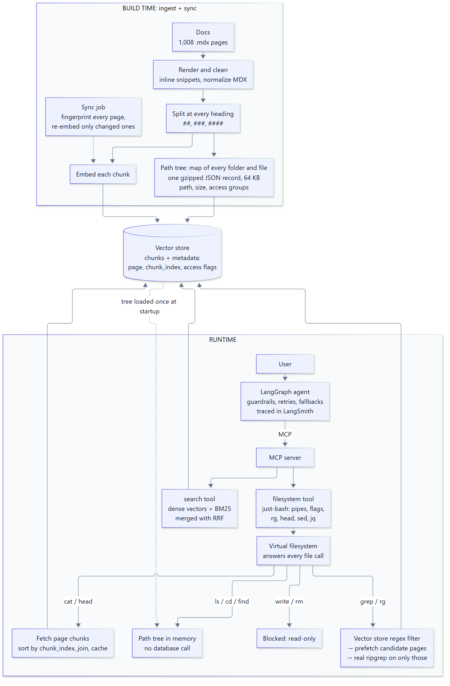

# docs-agent-lab

**A virtual filesystem for documentation agents.** The agent explores your docs with real shell commands
(`ls`, `cat`, `grep`, `head`, `sed`), but there is no disk and no sandbox: every command is answered from the
vector store you already use for search.

Inspired by [Mintlify's ChromaFs](https://www.mintlify.com/blog/how-we-built-a-virtual-filesystem-for-our-assistant),
rebuilt from scratch over 1,008 pages of documentation, with a LangGraph agent, an MCP server and LangSmith tracing.



---

## Why

There are two common ways to give an agent your docs, and both have a cost.

**Traditional RAG** splits pages into chunks and hands the model the top-k most similar to the question. It works for
one-topic questions. When the answer is spread across pages, or one page says *"see section 4.2 of another page"*,
retrieval returns the pointer but never the page it points to. Docs are a web of linked pages; RAG reads them as a pile
of loose paragraphs.

**A real sandbox** (clone the docs into a container, give the agent a shell) lets the agent follow links and grep for
exact strings, which agents are very good at. But every session waits for a machine to boot and pays for one. Mintlify
measured about **46 s** per session and **over $70k a year** at 850,000 conversations a month.

**A virtual filesystem** keeps the shell and drops the machine. The agent sees folders and files; a thin layer turns each
command into a query against the vector store. Sessions start in milliseconds, nothing can be written, and access
control is just "this page isn't in your tree".

## How it works

The vector store holds two kinds of records:

* **Chunks:** every page is split at its headings (`##`, `###`, `####`). Each chunk carries its page path, its
  position (`chunk_index`) and which groups may read it. These chunks double as the files: there is no second copy
  of the docs.
* **The path tree:** one gzipped JSON record mapping every folder and file (title, size, chunk count, access groups).
  For 1,008 pages it is **64 KB**. It is loaded into memory once at startup.

```
📁 docs
  📁 accounts
    📄 joint-accounts
  📁 disputes
    📄 how-to-dispute
  📁 internal
    📄 fraud-playbook   ← only users in the "staff" group see this
```

What runs behind each command (measured with `DOCS_DEBUG_QUERIES=1`):

| Command | What happens | Vector store queries |
|---|---|---|
| `ls`, `cd`, `find`, `tree` | Answered from the path tree in memory | **none** |
| `cat page.mdx` (first time) | Fetch all chunks of the page, sort by `chunk_index`, join, cache | 1 (`where page = …`) |
| `cat page.mdx` (again) | Served from the page cache | **none** |
| `rg -l "pattern" /folder` | **Two-pass grep**: a regex filter in the vector store finds candidate pages (metadata only), they are prefetched in one batch, then real ripgrep runs on only those files | usually 2 |
| `cat openapi.json \| jq …` | Large specs are *lazy*: listed in the tree, fetched only when read | none |
| `echo x > file` | Every write fails with `EROFS: read-only file system` | none |

The shell itself is [just-bash](https://github.com/vercel-labs/just-bash) (pipes, flags, `rg`, `jq`, `sed`, …); this
project implements its `IFileSystem` interface on top of the vector store.

A second tool, **search**, finds where to look first: dense vectors and an in-memory BM25 index, merged with
Reciprocal Rank Fusion (local Chroma has no sparse/SPLADE index, which is a Chroma Cloud feature).

More detail: [how pages are rendered and chunked](docs/how-mintlify-chunks.md) · [tracing](docs/tracing.md) ·
[diagram source](docs/architecture.mmd).

## Results

From one hard, multi-part question (subagent approvals + conditional pauses + editable tool arguments + Postgres
persistence, spread over four pages). One question, not a benchmark:

| | Top-k RAG (same chunks) | Agent + virtual filesystem |
|---|---|---|
| Facts needed that reached the model | top-5: **2 of 9** · top-20: **4 of 9** (zero Postgres facts) | all four topics found |
| Answer quality | missing most parts | **4.5 of 5** requirements correct |
| How | one similarity search | 4 searches + 20 targeted reads (`rg -n "^#"`, `sed -n '351,600p'`) |
| Cost / time | one model call | 25 tool calls, 199 s, about $0.08 (Qwen via OpenRouter) |

The half point it lost came from the docs themselves: two pages show a `PostgresSaver` usage the library rejects.

## Quickstart

Requires Python 3.11+, [uv](https://github.com/astral-sh/uv), Node 22+, [pnpm](https://pnpm.io) (for the UI).
On Windows Git Bash, prefix commands that pass `/paths` with `MSYS_NO_PATHCONV=1`.

**1. Install**

```bash
uv sync
cd server && npm install && cd ..
cd ingest && npm install && cd ..
```

**2. Get the docs** (text files only; the full repo is large because of images)

```bash
git clone --depth 1 --filter=blob:none --no-checkout https://github.com/langchain-ai/docs.git vendor/langchain-docs
cd vendor/langchain-docs
git sparse-checkout set --no-cone '/*.json' '/*.md' '/src/**/*.mdx' '/src/**/*.md' '/src/**/*.json' '/src/**/*.yaml' '/src/**/*.yml' '/src/**/*.jsx' '/src/**/*.js' '/pipeline/**' '/scripts/**' '/pyproject.toml' '/Makefile' '/uv.lock' '/packages.yml'
git checkout
PYTHONPATH="$(pwd)" uvx uv@0.9.30 run pipeline build
cd ../..
```

**3. Start the vector store and ingest** (about 7 minutes: 1,008 pages → ~11,500 chunks)

```bash
uv run chroma run --path ./chroma-data --host localhost --port 8000      # keep running
uv run python ingest/ingest.py --reset
```

**4. Start the docs server** (MCP on `http://localhost:3333/mcp`)

```bash
cd server && npm test && npm start
```

Try the filesystem without an agent:

```bash
cd server
npm run shell -- "tree / -L 2"
npm run shell -- 'rg -l "checkpointer" /oss/python/langgraph'
npm run shell -- --search "stream subgraph outputs"
DOCS_DEBUG_QUERIES=1 npm run shell        # interactive; prints every vector store query
```

**5. Add your keys** (asks with hidden input and writes `.env`)

```bash
uv run python scripts/set_keys.py         # OPENROUTER_API_KEY, LANGSMITH_API_KEY
```

**6. Start the agent** (LangGraph server on `http://localhost:2024`)

```bash
uv run langgraph dev --no-reload
```

`--no-reload` matters: `chroma-data/` changes every few seconds and would otherwise keep restarting the server.

**7. Start the chat UI** ([Agent Chat UI](https://github.com/langchain-ai/agent-chat-ui) plus a small branding patch)

```bash
git clone https://github.com/langchain-ai/agent-chat-ui.git vendor/agent-chat-ui
cd vendor/agent-chat-ui
git checkout 675be8e530d6ecc78ad44f698c5a64d8b0c3c2cc
git apply ../../ui/agent-chat-ui-branding.patch
cp ../../ui/.env.example .env
pnpm install && pnpm build && pnpm start       # http://localhost:3000
```

The patch removes the upstream logo, title and links, makes the app name configurable (`NEXT_PUBLIC_APP_NAME`) and
fixes a React `clip-path` warning.

## Keeping it in sync

`ingest/sync.py` updates only what changed:

```bash
uv run python ingest/sync.py               # fetch the docs, rebuild, apply changes
uv run python ingest/sync.py --dry-run     # show added / changed / removed pages
uv run python ingest/sync.py --every 600   # repeat every 10 minutes
```

1. Every page is fingerprinted (chunks + metadata) and compared with what is **actually stored** in the vector store,
   so a sync also repairs drift. Unchanged pages are skipped; a no-op sync takes about 6 s.
2. Only added or changed pages are re-embedded.
3. Writes happen in a safe order (new chunks → remove leftovers → new path tree → delete removed pages), so readers
   never see a missing page.
4. The running server reloads on its own (`POST /admin/reload` from the sync, plus a revision poll every 15 s) and drops
   only the cached pages that changed.
5. It refuses to pull if the local docs checkout has edits.

## The agent

A LangGraph deep agent (`deepagents.create_deep_agent`) that connects to the docs server over MCP. Its prompt, tools
and middleware are adapted from LangChain's open-source [chat-langchain](https://github.com/langchain-ai/chat-langchain)
(MIT, see `agent/LICENSE-chat-langchain`).

| Piece | What it does |
|---|---|
| Ingress guard | Caps a user message at 50,000 characters |
| Guardrails | A small model classifies each question as allowed or blocked (lenient; it fails open), and off-topic questions get a short refusal without running the main agent |
| Summarization | Past 130k tokens, older messages are summarized and the last 30k kept |
| Model retry / fallback | Retries failed calls, then falls back across models |
| Tool retry | Retries transient tool failures with backoff |
| Tools | docs search, docs filesystem, `check_links`, pricing page |

Models (all via [OpenRouter](https://openrouter.ai), set in `agent/config.py`): `qwen/qwen3.8-flash` (main),
`qwen/qwen3.7-flash` (guardrails, first fallback), `qwen/qwen3-235b-a22b-2507` (second fallback).

**Tracing:** every run goes to LangSmith with tags, prompt provenance, an agent version fingerprint and the guardrails
decision on the trace. `scripts/check_tracing.py` asks real questions and verifies each field. See
[docs/tracing.md](docs/tracing.md).

## Configuration

| Variable | Where | Default |
|---|---|---|
| `OPENROUTER_API_KEY`, `LANGSMITH_API_KEY` | `.env` | required for the agent |
| `LANGSMITH_PROJECT` | `.env` | `docs-agent-lab` |
| `DOCS_MCP_URL` | `.env` | `http://localhost:3333/mcp` |
| `GUARDRAILS_SAMPLE_TO_DATASET` | `.env` | `false` (opt in to save sampled questions to a LangSmith dataset) |
| `CHROMA_HOST`, `CHROMA_PORT`, `PORT` | docs server env | `localhost`, `8000`, `3333` |
| `DEFAULT_GROUPS` | docs server env | `public` |
| `TREE_POLL_SECONDS` | docs server env | `15` |
| `DOCS_DEBUG_QUERIES` | docs server env | off |
| Access rules | `ingest/access.json` | path prefix → groups (longest prefix wins) |

## Project structure

```
agent/          LangGraph agent: graph, prompts, middleware, tools, LangSmith routes (webapp.py)
docs/           architecture diagram, chunking notes, tracing notes
ingest/         ingest.py (build), sync.py (incremental updates), normalize-mdx.mjs, access rules
scripts/        set_keys, check_tracing, test_sync, push_prompts, compare_with_mintlify
server/         TypeScript MCP server: chroma-fs.ts, grep-accel.ts, search.ts, store.ts, server.ts
tests/          unit tests and evals for the agent
ui/             Agent Chat UI branding patch + .env example
langgraph.json  LangGraph server config
```

## Tests

```bash
uv run pytest tests/unit                          # agent unit tests (no keys needed)
cd server && npm test                             # 12 filesystem checks: tree, cat, grep, lazy files, RBAC, EROFS…
uv run python scripts/test_sync.py                # add / edit / delete a page and verify the live server follows
uv run python scripts/check_tracing.py --off-topic   # real questions, then checks the LangSmith traces (needs keys)
```

## Notes and limitations

* **Identity is demo-only:** the docs server reads groups from an `x-docs-groups` header. In production, derive them
  from a verified session.
* **Images aren't understood:** an `` survives only as its path and alt text. Mermaid diagrams survive as text.
* **just-bash blocks network calls inside `exec()`**, so the filesystem's database reads run in its trusted scope
  (`DefenseInDepthBox.runTrustedAsync`).
* **Fidelity to Mintlify:** chunk boundaries and page rendering match the live `docs.langchain.com/mcp` server on
  98–100% of sampled pages (images excluded); Mintlify's auto-generated API reference pages are not reproduced.

## Credits

* [Mintlify](https://www.mintlify.com/blog/how-we-built-a-virtual-filesystem-for-our-assistant): the virtual
  filesystem idea (ChromaFs)
* [chat-langchain](https://github.com/langchain-ai/chat-langchain) (MIT): agent prompt, middleware and tools
* [Agent Chat UI](https://github.com/langchain-ai/agent-chat-ui) (MIT): chat interface
* [just-bash](https://github.com/vercel-labs/just-bash) (Apache-2.0): the shell
* [LangChain docs](https://github.com/langchain-ai/docs) (MIT): the documentation used for testing (not included in
  this repo; downloaded in step 2)

## License

[MIT](LICENSE). Third-party parts keep their own licenses (see Credits).
